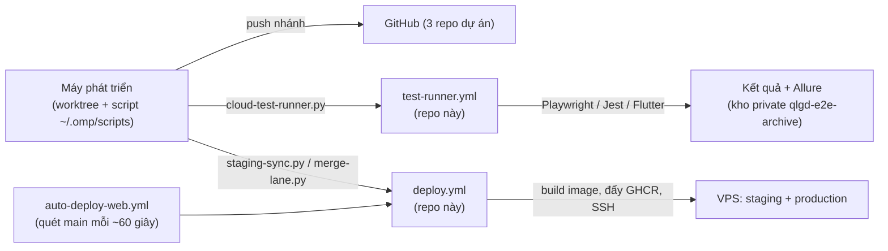

# Agent Orchestrator (OMP chạy trên GitHub Actions)

Bộ điều phối để **đẩy việc đang làm dở từ máy local lên cloud và làm tiếp**, cho cả cụm dự án giải đấu
(Backend, Web, App, ...). Bản thân repo này không chứa code dự án, chỉ chứa workflow.

Repo này là **trung tâm chạy việc nặng** của cụm dự án Sporto (`sporto.asia`): máy phát triển yếu, nên test nặng, deploy và quét bảo mật chạy ở đây trên runner GitHub. Repo **public** nên runner chuẩn không tính phút; vì vậy mọi log công khai đều đã được lọc (không có địa chỉ VPS, khoá hay output thô).

## Tổng quan: 4 repo và ai làm gì

| Repo | Là gì | Test chạy ở đâu | Deploy lên đâu |
|---|---|---|---|
| [`HethongBackendApi_QuanlyGiaiDau`](https://github.com/babydanh/HethongBackendApi_QuanlyGiaiDau) | Backend NestJS | `ci.yml` của repo (nhẹ) + `test-runner.yml` ở đây (target `backend`, `api-contract`, `fullstack-e2e`) | VPS qua `deploy.yml` **của repo này** |
| [`HethongFrontEndWeb_QLgiaidau`](https://github.com/babydanh/HethongFrontEndWeb_QLgiaidau) | Web Next.js | `ci.yml` của repo (nhẹ) + `test-runner.yml` (target `fullstack-e2e`, `web`) | VPS qua `deploy.yml` **của repo này** |
| [`HethongFrontEndApp_QLgiaidau`](https://github.com/babydanh/HethongFrontEndApp_QLgiaidau) | App Flutter | `ci.yml` của repo + `test-runner.yml` (target `app`, `app-e2e`) | Không deploy production. iOS/App Store: `deploy-ios.yml` **trong repo App**, chạy tay |
| `agent-orchestrator` (repo này) | Workflow, script deploy, script test | Test script Python (`scripts/**/test_*.py`) | Không có |

Môi trường: **production** = `https://sporto.asia`, **staging** = `https://staging.sporto.asia` (chung một VPS, tách container và compose).



## Cài đặt

### 1. Yêu cầu
- Tài khoản GitHub có quyền ghi 4 repo ở trên, `gh` CLI đã đăng nhập (`gh auth login`)
- Python 3 và PowerShell 7 (`pwsh`) trên máy phát triển
- Một VPS chạy Docker cho staging và production (đã có compose cho Backend/Web)

### 2. Lấy repo

```bash
git clone https://github.com/babydanh/agent-orchestrator.git
```

### 3. Đặt secrets và environment
Làm một lần, chạy lại được (bước nào xong thì bỏ qua):

```powershell
pwsh -File scripts\setup-deploy.ps1 [-BackendRepo <đường dẫn clone Backend>]
```

Script tạo environment `production` và `staging`, đặt secret VPS (SSH key, known_hosts, host, port, user, thư mục compose, khoá Basic Auth staging) và mở trang cấp quyền package GHCR. Danh sách secret đầy đủ ở mục [Secrets cần có](#secrets-cần-có-settings---secrets-and-variables---actions). Không commit giá trị secret.

### 4. Cài công cụ phía máy phát triển
Các lệnh dưới đây nằm trong `~/.omp/scripts/` (cấu hình chung của OMP trên máy), không nằm trong repo này:

| Script | Làm gì |
|---|---|
| `cloud-test-runner.py` | Gọi `test-runner.yml`, chờ xong, in kết quả; `summary`, `ds`, `xem` để đọc lỗi và xem báo cáo |
| `staging-sync.py` | Đẩy nhánh việc lên `staging` rồi gọi deploy staging |
| `merge-lane.py` | Rebase, chạy kiểm tra, (tuỳ chọn `--push`) đẩy `main` rồi gọi deploy production |
| `orchestrator-deploy.py` | Gọi `deploy.yml` (dùng nội bộ bởi hai script trên, gọi tay được) |
| `e2e-impact.py` | Chọn spec Playwright bị ảnh hưởng bởi thay đổi |

Biến môi trường người dùng `ORCH_DISPATCH_TOKEN` (token GitHub có quyền dispatch workflow) cho `cloud-test-runner.py`. Không in, không ghi file.

## Cách dùng (theo việc cần làm)

| Muốn | Lệnh | Chạy workflow nào |
|---|---|---|
| Chạy một spec E2E Web trên cloud | `python ~/.omp/scripts/cloud-test-runner.py run --target fullstack-e2e --web-ref <nhánh> --specs test/e2e/<tên>.spec.ts` | `test-runner.yml` |
| Chạy test Backend (Jest) | `... run --target backend --branch <nhánh>` | `test-runner.yml` |
| Kiểm hợp đồng OpenAPI | `... run --target api-contract --backend-ref <nhánh>` | `test-runner.yml` |
| Test App (analyze + test) | `... run --target app --branch <nhánh>` | `test-runner.yml` |
| E2E App trên emulator | `... run --target app-e2e --app-ref <nhánh> --specs integration_test/<tên>_test.dart` | `test-runner.yml` |
| Đọc lỗi lượt vừa chạy | `... summary <run_id\|last>` | (đọc log) |
| Xem ảnh/video/trace E2E | `... xem <run_id\|last>` | (kho `qlgd-e2e-archive`) |
| Lên **staging** | `python ~/.omp/scripts/staging-sync.py <worktree Backend> <worktree Web> --branch <nhánh>` (commit hết trước) | `deploy.yml` env=staging |
| Lên **production** | `python ~/.omp/scripts/merge-lane.py <worktree> --check "<test liên quan>" --push` | `deploy.yml` env=production |
| Deploy tay | `gh workflow run deploy.yml -R babydanh/agent-orchestrator -f project=backend\|web -f env=staging\|production -f sha=<40 ký tự>` | `deploy.yml` |
| Quét bảo mật | `gh workflow run security-scan.yml -R babydanh/agent-orchestrator -f target=all -f ref=main` | `security-scan.yml` |
| Chụp trang Web trên iPhone (Safari thật, simulator) | `gh workflow run ios-safari-shot.yml -R babydanh/agent-orchestrator -f paths=/live` | `ios-safari-shot.yml` |
| Đẩy việc dở lên cloud làm tiếp | nói "đẩy session lên github làm tiếp" (`scripts/fast-handoff.ps1`) | `agent-task.yml` |

Chỉ `--specs` cho spec liên quan; chạy cả bộ (`--all-specs`, 4 máy song song, ~26 phút) chỉ khi thật cần.

## Danh sách workflow

| Workflow | Kích hoạt | Làm gì |
|---|---|---|
| `test-runner.yml` | Tay (`workflow_dispatch`), hoặc lịch đêm 02:00 giờ VN | Test Backend, Web, App, E2E full-stack, E2E App |
| `deploy.yml` | Tay, hoặc gọi bởi `merge-lane.py` / `staging-sync.py` / `auto-deploy-web.yml` | Build image, đẩy GHCR, deploy Backend/Web lên VPS (staging hoặc production) |
| `auto-deploy-web.yml` | Lịch (cron `*/5`, tự lặp ~60 giây) | So SHA mới nhất của `main` Web/Backend với các lần đã deploy; SHA chưa deploy thì gọi `deploy.yml` production |
| `staging-refresh-db.yml` | Tay, phải gõ `REFRESH` | Chép đè DB staging từ bản sao production |
| `agent-task.yml` | Mở Issue / gắn nhãn `agent-task` / tay | Chạy tiếp session OMP trên cloud (xem mục sau) |
| `security-scan.yml` | Tay, thứ Hai 02:20 UTC | Gitleaks, OSV-Scanner, Semgrep |
| `ios-safari-shot.yml` | Tay | Chụp/quay trang trên Safari iOS (simulator macOS) |
| `deploy-log.yml`, `vps-diagnose.yml`, `vps-livestream-log.yml` | Tay | Đọc log deploy / tình trạng VPS (chỉ đọc) |
| `prod-seed-venues.yml`, `staging-seed-venues.yml`, `staging-venue-probe.yml`, `prod-tournament-fee-mode.yml` | Tay | Nạp/kiểm dữ liệu sân, chế độ phí giải (production tự `pg_dump` sao lưu trước khi áp) |
| `k6-live-load.yml`, `web-capacity.yml`, `web-cpu-profile.yml` | Tay | Đo tải staging, sức chứa Web, CPU profile |
| `deploy-salesbot.yml` | Tay (hoặc `auto-deploy-web.yml` khi bật `SALESBOT_AUTO_DEPLOY`) | Deploy `salesbot-admin` (dự án khác) |
| `cleanup-merged.yml` | Khi merge Pull Request | Dọn nhánh/session (quy trình hiện không dùng PR nên ít chạy) |

> **Lưu ý:** workflow `deploy.yml` / `deploy-staging.yml` trong repo Backend và Web đã bị **tắt**; deploy chỉ chạy ở repo này. Đẩy `main` của Backend/Web kéo theo deploy production (qua `merge-lane.py` hoặc `auto-deploy-web.yml`), nên không push thẳng `main`.

---

## Mục tiêu

Trước khi đi ngủ, bạn nói "đẩy lên cloud làm tiếp". Session dở dang được lưu và đẩy lên GitHub, cloud được cấu hình
để chạy tiếp **đúng session đó** rồi báo kết quả vào Issue. Không hẹn giờ: bạn nói là chạy ngay.

## Luồng hiện được cấu hình (chưa có bằng chứng chạy trọn vẹn)

1. **Local**: nói "đẩy session lên github làm tiếp". Script `fast-handoff.ps1` sẽ:
   - commit + push nhánh đang làm dở;
   - đẩy file session `.jsonl` lên nhánh `omp-sync/sessions`;
   - tạo một **Issue** `[Handoff] ...` chứa `Session-ID`, `Repo mục tiêu`, `Branch dở dang`, checklist.
2. **Cloud** (`agent-task.yml`) chạy khi chủ repo **mở** Issue, hoặc **gắn nhãn `agent-task`** (cách chạy lại một Issue;
   nhãn khác không kích hoạt), hoặc dispatch tay. Mỗi Issue chỉ một run cùng lúc, lần kích hoạt thêm xếp hàng:
   - kéo các repo dự án về, checkout đúng nhánh dở dang (`**Branch dở dang**:` = làm tiếp chính nhánh đó). Issue ghi
     `**Branch nền**:` / `**Nhánh nền**:` / `**Branch dở dang (nền)**:` thì làm trên nhánh riêng `omp/issue-N` tách từ
     nhánh nền, không đẩy thẳng vào nhánh nền. Tên nhánh luôn là `omp/issue-N` (tên khác ghi trong issue, như "Nhánh của
     chuỗi này", không được dùng); muốn gộp vào nhánh nền thì gộp `omp/issue-N`. Không repo nào có nhánh nền thì dừng;
   - tải session từ `omp-sync/sessions` và chạy `omp --continue` để làm tiếp;
   - bước 7 (`scripts/agent/push-work.sh`, có test) đẩy code **thẳng lên nhánh** (`omp/issue-N` hoặc nhánh dở dang),
     không tạo Pull Request; chạy cả khi agent lỗi/quá giờ. Gom việc dở ở thư mục clone và mọi git worktree; nhánh
     trên origin có commit mới trong lúc chạy thì gộp vào; xung đột thì đẩy sang `<nhánh>-agent-run<id>`, không ép;
   - báo kết quả (pass/fail + link run + nhánh đã push + **số file khác main**, 0 nghĩa là agent không để lại code)
     vào Issue **chỉ khi chạy do Issue kích hoạt**; dispatch tay thì không có comment; lưu lại session;
   - job `e2e` chạy Playwright qua `test-runner.yml` trên nhánh của việc (spec issue ghi; issue không ghi thì spec nhánh
     thêm/sửa; `E2E: toàn bộ` thì cả bộ). Có test đỏ thì chạy
     lại đúng các spec đó trên nhánh nền (hoặc `main`): test cũng đỏ ở đó là lỗi có sẵn, không gọi agent sửa; chỉ test
     đỏ mới mới tự chạy tiếp lượt sửa (tối đa 3). Không repo Web/Backend nào có nhánh của việc thì báo đỏ, không chạy
     E2E trên code không phải của việc (`scripts/agent/e2e-run.sh`, có test).
3. **Kéo về local** khi muốn làm tiếp ở máy: `cancel-cloud-and-pull.ps1`, rồi `omp --resume`.

## Chưa làm (không có trong workflow hiện tại)

- **Tự merge vào `main`**: chưa có. Workflow chỉ push lên nhánh. Merge vào `main` của Web/Backend sẽ kích hoạt
  `deploy.yml` (deploy production), nên nếu làm thì chỉ nên merge khi toàn bộ kiểm tra xanh.
- **Hẹn giờ chạy**: không dùng. Chạy ngay khi có Issue hoặc dispatch tay.
- `cleanup-merged.yml` chỉ chạy khi một Pull Request được merge. Vì quy trình không dùng PR nên file này không kích hoạt.

## Test chạy ở đâu

- Session **trên máy bạn**: test nhẹ (vài file) chạy trên máy; test nặng (E2E full-stack, cả bộ Flutter, pytest AICheckVAR)
  đẩy lên `test-runner.yml` theo skill `cloud-test-runner` (`~/.omp/scripts/cloud-test-runner.py`).
- Session **trên cloud** (`agent-task.yml`): test chạy trên cloud.
- `test-runner.yml` chỉ chạy khi được dispatch (bạn bấm tay hoặc session local theo skill), không hẹn giờ.
  - `fullstack-e2e`: Postgres + Redis + Backend + Web rồi chạy Playwright (video MỌI test, `E2E_VIDEO=on`).
    - Chọn spec (`specs`): 1 máy, ~5 phút cho 1 spec.
    - Cả bộ (`specs` trống): 4 máy song song, mỗi máy DB/Backend/Web riêng. `scripts/e2e/shard_specs.py` chia file
      cân theo thời gian đã đo (`scripts/e2e/spec-durations.json`), job `report-fullstack` gộp Allure. Run
      39153169825 (18/10): xong ~26 phút; trước đó 1 máy chạy tới timeout 60 phút chưa hết bộ. Khi xanh, mỗi
      shard ~8 phút test (ước tính từ số đo, chưa có lượt xanh để xác nhận); test đỏ chạy lại 2 lần nên kéo dài.
    - Backend dựng song song với cài gói Web; `next build` chạy sau khi Backend đã seed và mở cổng (build gọi API).
    - Báo cáo KHÔNG lên artifact (repo này public, artifact ai cũng tải được). `scripts/e2e/allure_archive.py` lưu mỗi
      lượt thành một GitHub Release của repo PRIVATE `babydanh/qlgd-e2e-archive` (lưu mãi): `allure-report.zip`
      (dashboard + video/ảnh/trace), `playwright-report.zip` (trace viewer), `history.zip` (lượt sau dùng cho biểu đồ
      xu hướng), `summary.json`; mục lục `index.json` + `README.md` của repo kho. Cả bộ: mỗi shard đẩy kết quả thô vào
      release nháp `tmp-<run_id>`, `report-fullstack` gộp, publish rồi xoá bản nháp. Lưu kho lỗi không làm job đỏ;
      `no_report=true` thì không lưu media ở đâu. `GH_PAT` cần quyền ghi (Contents) repo kho; repo chưa có thì script
      tạo private, repo không private thì từ chối tải lên.
  - `web`: Playwright KHÔNG có backend (API SSR rơi về production) — không dùng để xác minh. `all` không chạy job này.
    Báo cáo lưu kho như trên, project `qlgd-web-ui`.
  - `backend` (Jest), `app` (`flutter analyze` + `flutter test`, không thiết bị thật), `aicheckvar` (pytest).
  - `auto25d`: hỏng — repo `Auto25D-Remotion` "not found" trên run 12/10.
- Đọc lỗi: `python ~/.omp/scripts/cloud-test-runner.py summary <run_id|last>`.

## Quét bảo mật Backend / Web / App (`security-scan.yml`)

- Chạy tay: `gh workflow run security-scan.yml -f target=all -f ref=main` (`target`: `all`, `backend`, `web`, `app`). Tự chạy mỗi thứ Hai 02:20 UTC. Chưa nối deploy gate.
- Quét tĩnh, không cài dependency và không chạy code của repo được quét:
  - Gitleaks 8.30.1 (CLI, không dùng gitleaks-action): toàn bộ lịch sử mọi nhánh.
  - OSV-Scanner 2.7.0: mọi lockfile đã track (`pnpm-lock.yaml`, `package-lock.json`, `yarn.lock`, `pubspec.lock`).
  - Semgrep 1.181.0 CE với quy tắc cục bộ `scripts/security/rules/semgrep-ts-js.yml` (SQL nội suy, exec động, eval, `dangerouslySetInnerHTML` động). Trước mỗi lượt quét, `scripts/security/semgrep_selftest.py` chạy fixture lỗi (phải bị bắt đủ) và fixture an toàn (phải sạch).
- Phạm vi: Backend và Web có đủ ba scanner. App (Flutter/Dart) chỉ có Gitleaks và OSV: Semgrep coi Dart là thử nghiệm nên không có SAST cho App.
- Ghim và kiểm: binary và wheel được ghim phiên bản cùng SHA256 từ nguồn chính thức. Dependency transitive của Semgrep lấy từ PyPI, chưa ghim hash.
- Quyền và token: workflow chỉ có `contents: read`. Clone repo mục tiêu dùng `GH_PAT` qua biến môi trường `GIT_CONFIG_*`, token không vào `.git/config` hay URL. Tối đa 2 job song song.
- Kết quả:
  - Log và step summary công khai chỉ có số lượng, trạng thái, SHA. Không có đường dẫn file, snippet, giá trị secret hay stderr.
  - Chi tiết (rule/advisory, gói@phiên bản, file, dòng, commit) chỉ vào issue private: Web ghi trong repo Web; Backend/App ghi trong `babydanh/omp-global-config` vì hai repo mục tiêu đang public. Tiêu đề chứa tên repo để không trộn báo cáo.
  - Job đỏ với "có phát hiện" khi có finding. Job đỏ với "lỗi hạ tầng" khi scanner lỗi, thiếu lockfile, không quét được file, hoặc không đọc/ghi được issue. Hai loại được tách riêng trong summary.
- `GH_PAT` cần Contents read trên 3 repo mục tiêu và Issues read/write trên Web và `omp-global-config`. Không ghi được báo cáo private thì job báo lỗi hạ tầng, không bỏ qua.
- Gitleaks quét cả lịch sử, nên secret đã xoá khỏi nhánh hiện tại vẫn bị báo nếu còn trong commit cũ.

## Deploy Backend / Web lên VPS (`deploy.yml`, `staging-refresh-db.yml`)

- Thay `deploy.yml` / `deploy-staging.yml` / `staging-refresh-db.yml` trong repo Backend và Web: repo private hết phút Actions thì bị chặn, repo này public nên runner chuẩn không tính phút. Image vẫn ở GHCR cũ (`hethongbackendapi_quanlygiaidau`, `hethongfrontendweb_qlgiaidau`), compose trên VPS không đổi.
- Gọi tự động: `merge-lane.py --push` lên `main` gọi deploy production đúng SHA vừa push; `staging-sync.py` gọi deploy staging sau khi push `staging` (cả hai qua `~/.omp/scripts/orchestrator-deploy.py`). Gọi tay:
  - `python ~/.omp/scripts/orchestrator-deploy.py <repo Backend|Web> --env staging|production [--sha <sha>] [--refresh-db] [--dry-run] [--watch]`
  - hoặc `gh workflow run deploy.yml -f project=backend|web -f env=staging|production -f sha=<40 ký tự>`.
- Luồng: kiểm SHA nằm trên `main` (production) hoặc `staging` (staging) của repo đích → Backend production chạy migrate trên PostGIS sạch hai lần + `pnpm test`; Web chạy `tsc` + `i18n:check` → build image, push GHCR (cache build ở tag `buildcache` của chính package) → SSH lên VPS làm đúng các bước của workflow cũ (pull, migrate, thay container, smoke; staging còn kiểm khoá Basic và container prod không đổi ID). `dry_run=true`: dừng sau build, không push.
- Log công khai: không có địa chỉ/cổng/thư mục VPS (secret của environment), không có output thô của install/test/build/migrate (`scripts/deploy/quiet.sh` chỉ in OK, hoặc khi lỗi chỉ in mã lỗi tsc/pnpm và dòng tổng kết, không in đường dẫn hay nội dung lỗi). Log đầy đủ phần chạy trên VPS: `/var/log/sporto-deploy/` trên VPS. Không upload artifact.
- Danh tính máy chủ kiểm bằng `VPS_KNOWN_HOSTS` ghim lúc thiết lập (`StrictHostKeyChecking=yes`), không `ssh-keyscan` mỗi lượt.
- Thiết lập một lần: `pwsh -File scripts\setup-deploy.ps1` (tạo environment, đặt secret, hỏi khoá SSH / mật khẩu staging / khoá API Web, mở trang cấp quyền package). Chạy lại được, bước đã xong thì bỏ qua.

## Secrets cần có (Settings -> Secrets and variables -> Actions)

- `GH_PAT`: kéo/đẩy code vào các repo dự án (cần Contents, Actions, Issues).
- `OPENROUTER_API_KEY`: model dự phòng cho OMP.
- `OMP_CODEX_AUTH`: token Codex OAuth cho OMP.
- `NEXT_PUBLIC_APP_API_KEY`: build-arg của image Web (deploy.yml).
- Environment `production` và `staging` (chỉ chạy từ `main`), mỗi cái có: `VPS_SSH_KEY`, `VPS_KNOWN_HOSTS`, `VPS_HOST`, `VPS_PORT`, `VPS_USER`, `APP_DIR` (thư mục compose prod hoặc staging trên VPS). `staging` thêm `STAGING_BASIC_AUTH` (`user:matkhau`). Job khác trong repo (vd `agent-task.yml`) không khai environment nên không đọc được các secret này.
- Package GHCR của Backend và Web: Manage Actions access → thêm `agent-orchestrator` quyền Write (để `GITHUB_TOKEN` của repo này push image và VPS kéo image).

## Lưu ý đã biết

- Cloud chỉ thấy code **đã push lên GitHub**. Việc sửa dở chưa commit trên máy thì chưa lên cloud được.
- Repo này đang **public** (đã kiểm tra bằng GitHub API): không để dữ liệu nhạy cảm trong nhánh `omp-sync/sessions`.
- **Chưa có bằng chứng** các lần handoff trước đã resume và hoàn thành đúng. Các bước trên có trong `fast-handoff.ps1`
  và `agent-task.yml` (đã đọc code), nhưng chưa ai chạy trọn một vòng và đo kết quả. Không coi đây là tính năng đã kiểm chứng.
